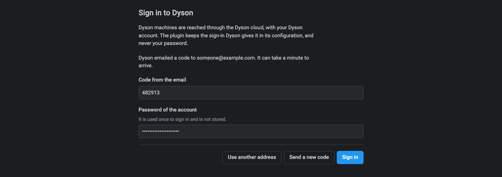
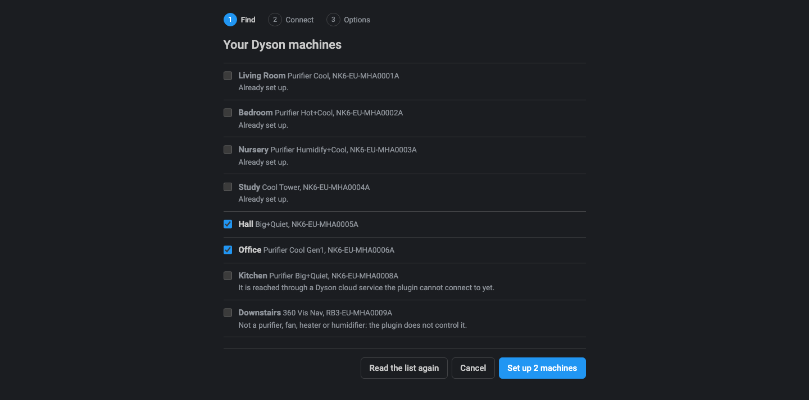
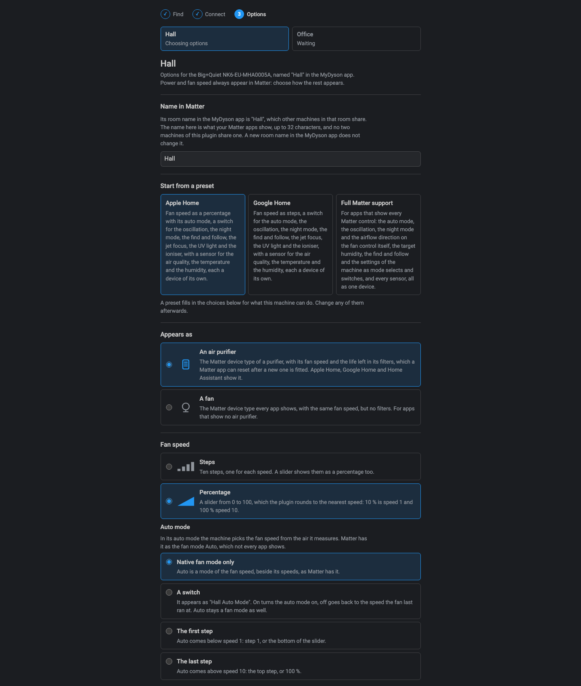
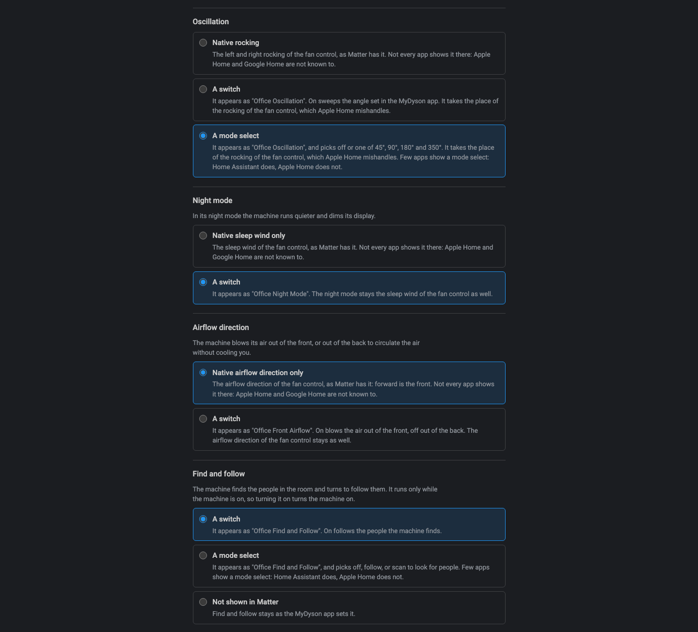
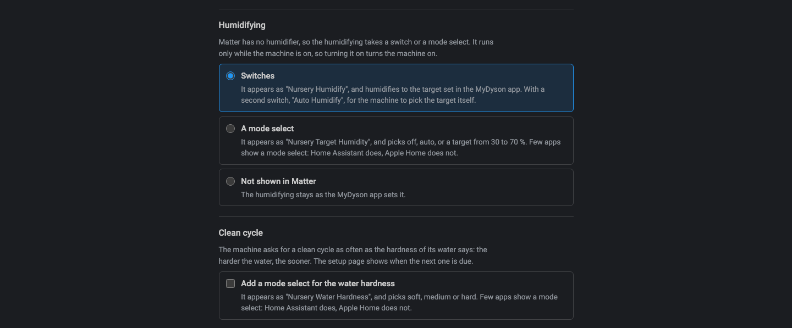
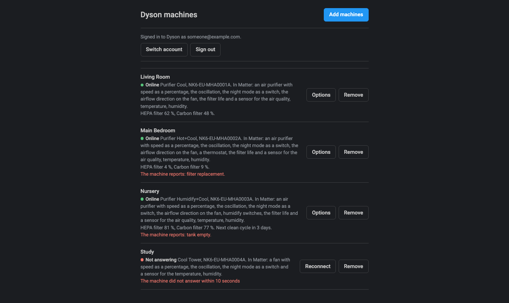
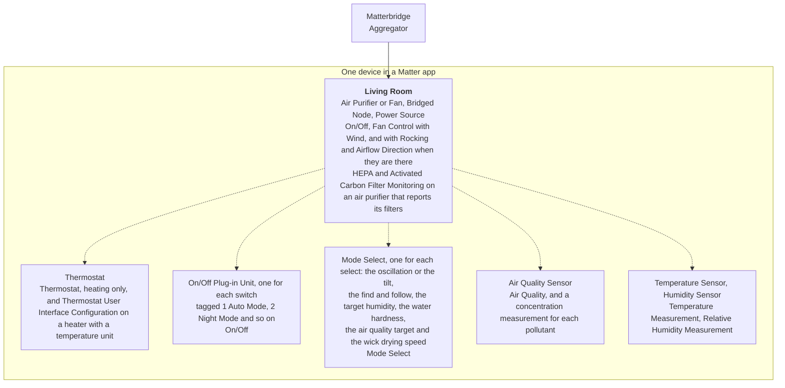

# Matterbridge Dyson Care

[](https://www.npmjs.com/package/matterbridge-dyson-care)
[](https://www.npmjs.com/package/matterbridge-dyson-care)
[](https://github.com/cheziyi/matterbridge-dyson-care/actions/workflows/build.yml)
[](https://github.com/cheziyi/matterbridge-dyson-care/actions/workflows/codeql.yml)
[](https://codecov.io/gh/cheziyi/matterbridge-dyson-care)
[](./LICENSE)

[](https://www.npmjs.com/package/matterbridge)
[](https://www.npmjs.com/package/dyson-control)

Control your Dyson purifiers, fans, heaters and humidifiers from Apple Home, Google Home, Alexa, Home Assistant and other Matter apps.

It is a [Matterbridge](https://matterbridge.io) plugin built on [dyson-control](https://www.npmjs.com/package/dyson-control), which reaches each machine through the Dyson cloud with your Dyson account, the way the MyDyson app does. It covers the environmental care machines dyson-control knows: see its [machines](https://github.com/cheziyi/dyson-control#machines) and its [coverage and limitations](https://github.com/cheziyi/dyson-control#coverage--limitations).

## Why this plugin

- **It finds your machines for you.** Sign in once in the setup page and it lists every machine of your Dyson account, with whether it can control each one. There is no serial number, credential or configuration file to look up: see [Guided setup](#guided-setup).
- **It fits the Matter app you use.** Matter apps differ in what they show, so you choose how each control appears: the oscillation, the night mode and the airflow direction on the fan itself or as switches, the auto mode as a fan mode, a switch or a step, and a mode select for the oscillation angle or the target humidity. Presets for Apple Home, Google Home and the apps with full Matter support give you a starting point: see [Presets](#presets).
- **It offers only what your machine can do.** The plugin reads which controls each machine carries from its type, its model, its variant and its firmware, and builds its device in Matter from that. A heater gets a thermostat, a humidifier its humidifying, a purifier its air quality sensor.
- **It reaches more of the machine than the power and the fan.** Besides the fan speed, the auto mode, the oscillation and the night mode, you get the oscillation angle, the tilt, the heating, the humidifying, find and follow, the filters, and switches for the child lock, the jet focus, the UV light, the ioniser and the like: see the [comparison](#compared-with-other-dyson-plugins).
- **It shows the air quality.** A purifier gets an air quality sensor with the air quality of its worst pollutant and each pollutant it measures: PM2.5, PM10, VOC, NO₂, formaldehyde and CO₂.
- **You name each machine.** The MyDyson app names a machine after its room, which several machines can share: the setup page starts from that name and lets you give each machine a name of its own in Matter. A machine whose firmware gains a control gets it.
- **It says when a machine stops answering.** After two reads in a row fail, or when its connection to the Dyson cloud does not open again, your Matter app shows the machine as unreachable, and it comes back by itself as soon as the machine answers again.
- **Nothing needs a restart.** Sign in, add, change and remove machines while Matterbridge keeps running.

## Requirements

- Matterbridge 3.10.10 or later.
- Node.js 22.13 or later (22, 24 or 26). Node.js 20 is not supported, because dyson-control needs Node.js 22.
- A Dyson account that signs in with an email address, with your machines added to it in the MyDyson app. The plugin finds the machines of that account: it does not create an account or add a machine itself, so set each machine up in the MyDyson app first.
- A route to the internet: the machines are reached through the Dyson cloud, not over the local network.

## Installation

In the Matterbridge frontend, type `matterbridge-dyson-care` in the **Install plugins** field and click **Install**, then restart Matterbridge.

From the command line instead:

```bash
npm install -g matterbridge-dyson-care
matterbridge --add matterbridge-dyson-care
```

Then set up your machines in the plugin's own page: see [Guided setup](#guided-setup).

## Guided setup

Open the plugin frontend from the plugin's row on the Matterbridge home page. The first time, it asks you to sign in:

- **Sign in.** Enter the email address and the country of your Dyson account, the one you use in the MyDyson app. Dyson emails you a code: enter it with your password. The password is used once and not stored.

Then it walks through three steps:

1. **Find.** The page lists the machines of your account and marks those already set up. It says why it cannot control one: a robot vacuum or another machine that is not a purifier, a fan, a heater or a humidifier, a machine of a type dyson-control does not know yet, or one reached through a Dyson cloud service it cannot connect to yet.
2. **Connect.** For each machine you picked, the plugin checks that it answers through the Dyson cloud, and reads which sensors it has.
3. **Options.** The name the machine gets in Matter, starting from its room name in the MyDyson app, whether it appears as an air purifier or a fan, and how the fan, the oscillation or the tilt, the night mode, the airflow direction, the find and follow, the heating, the humidifying, the clean cycle, the [more controls](#more-controls) and the readings appear in Matter, from what the machine can do, and whether they are one device or several. Start from a [preset](#presets) or choose each one yourself.

Afterwards the same page lists your machines with their status: online, connecting while a machine just added or rebuilt connects through the cloud, not answering, or not started. Under each machine it shows how it appears in Matter, the life left in its filters, its clean cycle, such as when the next one is due or how long one that runs has left, how long the drying of its wick has left, and the faults it reports, such as a filter to replace or an empty tank. From there you can add more, change the options of one, reconnect one that stopped answering, remove one, switch to another account, sign in again when the Dyson cloud no longer accepts the sign-in, or sign out. None of this needs a Matterbridge restart.

<table>
  <tr>
    <td width="50%" valign="top">
      
      <br><b>Sign in.</b> The code Dyson emails you, and your password, used once.
    </td>
    <td width="50%" valign="top">
      
      <br><b>Find.</b> The machines of your account, and why the plugin cannot control one.
    </td>
  </tr>
  <tr>
    <td valign="top">
      
      <br><b>Options.</b> Start from a preset, then choose how the machine and its fan appear.
    </td>
    <td valign="top">
      
      <br><b>Options.</b> The oscillation as a select of its angles, and find and follow.
    </td>
  </tr>
  <tr>
    <td valign="top">
      
      <br><b>Options.</b> The humidifying and the clean cycle of a humidifier.
    </td>
    <td valign="top">
      
      <br><b>Afterwards.</b> Your machines, their status, their filters and their faults.
    </td>
  </tr>
</table>

The screenshots show the setup page with simulated machines: the plugin's own setup API in front of a fake Dyson account, which is why the serial numbers run `NK6-EU-MHA0001A` and on. See [Development](#development) to take them again.

## How a machine appears in Matter

| In Matter         | From the machine                                                                                                                        |
| ----------------- | --------------------------------------------------------------------------------------------------------------------------------------- |
| Air purifier      | The machine, with its power and its fan speed. You can make it a fan instead: see [Air purifier or fan](#air-purifier-or-fan)           |
| Fan speed         | Speeds 1 to 10, as steps or as a percentage: see [Fan speed](#fan-speed)                                                                |
| Auto mode         | Your choice, on a machine that has one: see [Auto mode](#auto-mode)                                                                     |
| Oscillation       | Your choice, or the tilt of a machine that tilts, on a machine that has one: see [Oscillation](#oscillation) and [Tilt](#tilt)          |
| Night mode        | Your choice: see [Night mode and airflow direction](#night-mode-and-airflow-direction)                                                  |
| Airflow direction | Your choice, on a machine that blows its air to the front or the back                                                                   |
| Find and follow   | A switch or a mode select, on a machine that follows the people it finds: see [Find and follow](#find-and-follow)                       |
| Heating           | A thermostat or a switch, on a heater: see [Heating](#heating)                                                                          |
| Humidifying       | Switches or a mode select, on a humidifier: see [Humidifying](#humidifying)                                                             |
| Water hardness    | A mode select, on a humidifier that runs a clean cycle: see [Humidifying](#humidifying)                                                 |
| Filters           | The life left in each filter, on an air purifier that reports it: see [Filters](#filters)                                               |
| More controls     | Switches or mode selects for the child lock, the UV light and the like, on a machine that has them: see [More controls](#more-controls) |
| Readings          | An air quality sensor, a temperature sensor and a humidity sensor, each once the machine gives its reading: see [Readings](#readings)   |

A switch or a mode select is for the Matter apps that do not show a control in its place on the fan control: it comes beside that place, never in place of it, so the place stays for the apps that show it. A control that has a place on the fan control is never hidden, because an app that does not show the place leaves it out. The oscillation is the one exception: its switch or its select takes the place of the rocking, because Apple Home mishandles the rocking.

### How it is built in Matter

Matter describes a device as endpoints. Each endpoint has one or more device types, which say what it is, and clusters, which hold its attributes and commands. Each machine is one device: an endpoint for the air purifier or the fan, with every control or sensor that has no place on it as a part of it, on an endpoint of its own:



A solid line is always there. A dashed one is there when you choose it in the setup and the machine has it, and for a sensor once the machine gives its reading. The main endpoint also has the Bridged Node and Power Source device types, with the Identify, Bridged Device Basic Information and Power Source clusters: the name and the serial number of the machine, whether it is reachable, and that it runs on mains power. Its parts have the Identify cluster alone, because in Matter the rest belongs to the device. The setup can also make each part a device of its own: see [One device or several](#one-device-or-several).

| Device type         | ID     | Stands for                                            |
| ------------------- | ------ | ----------------------------------------------------- |
| Aggregator          | 0x000E | Matterbridge, which holds the devices it bridges      |
| Bridged Node        | 0x0013 | Each device: its name, serial number and reachability |
| Power Source        | 0x0011 | Each device: mains powered                            |
| Air Purifier        | 0x002D | The machine, as an air purifier                       |
| Fan                 | 0x002B | The machine, as a fan                                 |
| Thermostat          | 0x0301 | The heating of a heater                               |
| On/Off Plug-in Unit | 0x010A | Each switch                                           |
| Mode Select         | 0x0027 | Each select                                           |
| Air Quality Sensor  | 0x002C | The air quality and the pollutants                    |
| Temperature Sensor  | 0x0302 | The room temperature                                  |
| Humidity Sensor     | 0x0307 | The room humidity                                     |

An air purifier also has the HEPA Filter Monitoring (0x0071) and Activated Carbon Filter Monitoring (0x0072) clusters for its filters: see [Filters](#filters).

The names below, such as `<name> Night Mode`, are those of the parts as devices of their own, as the Apple Home and Google Home presets make them. As parts of the main device they have no name in Matter: a switch or a mode select is tagged with what it is, such as `Night Mode`, and a Matter app shows each part in its own way: see [One device or several](#one-device-or-several).

### Air purifier or fan

| Option       | In Matter                                                                                      |
| ------------ | ---------------------------------------------------------------------------------------------- |
| Air purifier | The Matter device type of a purifier. The presets pick it for a machine that measures the air  |
| Fan          | The Matter device type every app shows, with the same fan speed. The presets pick it for a fan |

Both have an on/off and a fan control. Setting the fan to off or 0 turns the machine off, and a speed turns it on.

### Fan speed

| Option     | In Matter                                                                                              |
| ---------- | ------------------------------------------------------------------------------------------------------ |
| Steps      | Ten steps, one for each speed, and a percentage beside them                                            |
| Percentage | A slider from 0 to 100. The plugin rounds it to the nearest speed: 10 % is speed 1, and 100 % speed 10 |

Matter also has the fan modes Low, Medium and High, which apps show as buttons or reach by voice. Each stands for a third of the percentage: Low up to 33 %, Medium up to 66 % and High above. A fan mode picked while the fan already runs in its third keeps the speed it has. Otherwise Matterbridge sets the middle percentage of that third, 17 %, 50 % or 84 %, which the plugin rounds to the nearest speed as it does any percentage: Low is speed 2, Medium speed 5 and High speed 8.

### Auto mode

In its auto mode the machine picks its fan speed from the air it measures. On a machine that has one, the setup puts it in one of these places:

| Option               | In Matter                                                                                                                                                    |
| -------------------- | ------------------------------------------------------------------------------------------------------------------------------------------------------------ |
| Native fan mode only | The Auto fan mode of the fan control, as Matter has it. Not every app shows it                                                                               |
| A switch             | The Auto fan mode, and a switch named `<name> Auto Mode` beside it. On turns the auto mode on. Off puts the fan back at the speed it last ran at, or speed 5 |
| The first step       | Below speed 1: step 1, or the bottom of the slider                                                                                                           |
| The last step        | Above speed 10: the top step, or 100 %                                                                                                                       |

A step takes the place of the Auto fan mode, because in that mode Matter holds no percent: the fan then has eleven steps. A fan mode picked outside its third then rounds to the nearest of those: with auto first, Low is speed 1, Medium speed 5 and High speed 8, and with auto last, Low is speed 2, Medium speed 6 and High speed 9. Turning the auto mode off on a machine that is off turns it on at that speed.

### Oscillation

A machine that dyson-control reads as not oscillating, such as the type 965, gets no oscillation in Matter and no choice in the setup.

| Option         | In Matter                                                                                                                                                                            |
| -------------- | ------------------------------------------------------------------------------------------------------------------------------------------------------------------------------------ |
| Native rocking | The left and right rocking of the fan control, as Matter has it. Not every app shows it                                                                                              |
| A switch       | A switch named `<name> Oscillation`, in place of the rocking. On sweeps the angle set in the MyDyson app                                                                             |
| A mode select  | A mode select named `<name> Oscillation`, in place of the rocking, with Off and the angles the machine sweeps: see below. Few Matter apps show it: see [Mode selects](#mode-selects) |

The mode select offers what the machine takes:

| Machine                             | Angles                                                                                                                              |
| ----------------------------------- | ----------------------------------------------------------------------------------------------------------------------------------- |
| One whose firmware takes two angles | The sweeps it takes, 45°, 90°, 180° and 350°, each centred where the machine oscillates now, within the 5° to 355° it turns through |
| One with preset angles              | Its presets: 45°, 90°, 180° and 350°, or 15°, 40° and 70° on some models                                                            |
| A humidifier whose barrel turns     | 45°, 90° and Breeze                                                                                                                 |

A sweep the select does not list, such as one set in the MyDyson app, leaves the select at what it showed before. A machine that oscillates only on and off gets no mode select, and nor does one whose firmware takes its two angles only as one direction, as on the types 635 and 739: the oscillation is a switch on them.

A machine that pauses its oscillation while it stands by takes it on and off in modes of their own, which the plugin sends in place of on and off while the machine stands by, as dyson-control asks.

### Tilt

The Big+Quiet tilts in place of oscillating: to 0°, 25° or 50°, or back and forth in its breeze. Its oscillation options are for the tilt:

| Option         | In Matter                                                                                                                                       |
| -------------- | ----------------------------------------------------------------------------------------------------------------------------------------------- |
| Native rocking | The up and down rocking of the fan control. On breezes, and off tilts the machine back to the angle it was at, or to 0°. Not every app shows it |
| A switch       | A switch named `<name> Oscillation`, in place of the rocking, which breezes the same way                                                        |
| A mode select  | A mode select named `<name> Tilt`, in place of the rocking, with 0°, 25°, 50° and Breeze                                                        |

A tilt turns a machine that is off on, as in the MyDyson app: see [Power](#power).

### Night mode and airflow direction

| Option      | Night mode                                                                        | Airflow direction                                                                                                                                   |
| ----------- | --------------------------------------------------------------------------------- | --------------------------------------------------------------------------------------------------------------------------------------------------- |
| Native only | The sleep wind of the fan control alone, as Matter has it. Not every app shows it | The airflow direction of the fan control alone: forward is the front. Not every app shows it                                                        |
| A switch    | A switch named `<name> Night Mode`, and the sleep wind of the fan control as well | A switch named `<name> Front Airflow`, and the airflow direction of the fan control as well. On blows the air out of the front, off out of the back |

The airflow direction is offered on a machine that blows its air to the front or the back.

### Find and follow

A machine that follows people, such as the Purifier Cool of variant N, finds the people in the room and turns to follow them. It runs only while the machine is on, so turning it on turns the machine on.

| Option        | In Matter                                                                                                                 |
| ------------- | ------------------------------------------------------------------------------------------------------------------------- |
| A switch      | A switch named `<name> Find and Follow`. On follows the people the machine finds, and it shows on while it looks for them |
| A mode select | A mode select named `<name> Find and Follow`, with Off, Follow and Scan, which looks for people                           |
| Not shown     | Find and follow stays as the MyDyson app sets it                                                                          |

### Heating

On a heater, the heating appears in one of these places. It runs only while the machine is on, so turning it on turns the machine on.

| Option       | In Matter                                                                                                                                                                     |
| ------------ | ----------------------------------------------------------------------------------------------------------------------------------------------------------------------------- |
| A thermostat | A thermostat that heats, with a setpoint from 1 to 37 °C in whole degrees, named `<name> Heater` as a device of its own. Off turns the heating off and leaves the fan running |
| A switch     | A switch named `<name> Heat`. It heats to the setpoint set in the MyDyson app                                                                                                 |
| Not shown    | The heating stays as the MyDyson app sets it                                                                                                                                  |

The thermostat shows it heating while the heater runs, as the machine says. A machine that does not say so shows it heating while the room is below the setpoint. A setpoint changed in Matter turns the heating on, as it does in the MyDyson app. On a heater that shows a temperature in °C or °F, the thermostat has that unit as its display mode, which a Matter app can set.

### Humidifying

Matter has no humidifier, so on a humidifier the humidifying appears in one of these places. It runs only while the machine is on, so turning it on turns the machine on.

| Option        | In Matter                                                                                                                                                                                          |
| ------------- | -------------------------------------------------------------------------------------------------------------------------------------------------------------------------------------------------- |
| Switches      | A switch named `<name> Humidify`, which humidifies to the target set in the MyDyson app, and one named `<name> Auto Humidify` on a machine that picks its own target                               |
| A mode select | A mode select named `<name> Target Humidity`, with Off, Auto on a machine that has it, and 30 %, 40 %, 50 %, 60 % and 70 %. A target the machine holds between two of them shows as the nearer one |
| Not shown     | The humidifying stays as the MyDyson app sets it                                                                                                                                                   |

Turning the `<name> Auto Humidify` switch on or off turns the humidifying on as well, to the target the machine picks or to the one set in the MyDyson app, as the MyDyson app does.

A humidifier that runs a clean cycle asks for one as often as the hardness of its water says: the harder the water, the sooner. It can get a mode select named `<name> Water Hardness`, with Soft, Medium and Hard. The setup page shows when its next clean cycle is due, and how long one that runs has left.

### Filters

An air purifier shows the life left in its filters, as Matter has it for a purifier. It needs no choice in the setup: an app that does not show filters leaves them out.

| Machine                     | In Matter                                                                                                                                           |
| --------------------------- | --------------------------------------------------------------------------------------------------------------------------------------------------- |
| One of the first generation | The HEPA filter, with the hours left of the 4300 a new filter has, as a percentage                                                                  |
| A later one                 | The HEPA filter, from the outer filter, and the activated carbon filter, from the inner filter, which shows as not fitted when the machine has none |

A filter warns that it is about to need replacing at 10 % or less, and needs replacing at 0 %. Resetting a filter in a Matter app, after fitting a new one, resets its life on the machine. Matter has filters on an air purifier alone, so a machine that appears as a fan shows none, and a machine that reports no filter life, such as the Cool Tower, has no filters in Matter. Which apps show the filters has not been tested with this plugin.

### Mode selects

A mode select is the Matter device type that picks one value from a list, as a drop-down does. **Few Matter apps show a mode select.** Home Assistant shows each one as a select among the settings of the device. Apple Home is reported not to show them, and Google Home, Amazon Alexa and SmartThings do not list them among the devices they support. This has not been tested with this plugin. In the other apps, the switches are the way to reach these controls.

### More controls

A machine that has one of these controls can get a switch or a mode select for it, which Matter has no place for beside the fan:

| Control            | In Matter                                                                                                                                                                                 | On                                             |
| ------------------ | ----------------------------------------------------------------------------------------------------------------------------------------------------------------------------------------- | ---------------------------------------------- |
| Child lock         | A switch named `<name> Child Lock`. On locks the buttons of the machine                                                                                                                   | The types 635, 739, 918, 965, 997 and 1018     |
| UV light           | A switch named `<name> UV Light`                                                                                                                                                          | The machines dyson-control reads as having one |
| Ioniser            | A switch named `<name> Ioniser`                                                                                                                                                           | The machines dyson-control reads as having one |
| Jet focus          | A switch named `<name> Jet Focus`. On focuses the air into one stream, and off diffuses it                                                                                                | The type 455                                   |
| Indirect airflow   | A switch named `<name> Indirect Airflow`. On tilts the nozzle to 45°, and off points it at 0°                                                                                             | The type 831                                   |
| Air quality target | A mode select named `<name> Air Quality Target`: the air quality the auto mode aims for, Good, Sensitive or Very Sensitive                                                                | Machines of the first generation               |
| Wick drying        | A switch named `<name> Wick Drying`, which dries the wick, and a mode select named `<name> Wick Drying Speed`: Slow, Normal or Fast, in 60, 45 or 30 minutes. Each is a choice of its own | The type 965                                   |

See dyson-control's [capabilities](https://github.com/cheziyi/dyson-control#capabilities) for which models have a UV light and an ioniser. The setup page offers each only on a machine that has it.

### Readings

| Reading     | In Matter                                                                                                                                                                                          |
| ----------- | -------------------------------------------------------------------------------------------------------------------------------------------------------------------------------------------------- |
| Air quality | An air quality sensor named `<name> Air Quality`, on a machine that measures the air. Its air quality is that of its worst pollutant, and it has a measurement of each pollutant the machine gives |
| Temperature | A temperature sensor named `<name> Temperature`. A thermostat shows the room temperature too                                                                                                       |
| Humidity    | A humidity sensor named `<name> Humidity`                                                                                                                                                          |

| Pollutant                    | In Matter                                                                               |
| ---------------------------- | --------------------------------------------------------------------------------------- |
| PM2.5, PM10 and formaldehyde | A concentration, in μg/m³                                                               |
| CO₂                          | A concentration, in parts per million                                                   |
| VOC and NO₂                  | A level, low, medium, high or critical, from the machine's own index, which has no unit |

Dyson rates the air from good to severe on one index for every pollutant, and Matter from good to extremely poor. The six bands are taken in order:

| Dyson index | Dyson          | Matter air quality | Matter level |
| ----------- | -------------- | ------------------ | ------------ |
| Under 4     | Good           | Good               | Low          |
| 4 to 7      | Fair           | Fair               | Medium       |
| 7 to 9      | Poor           | Moderate           | High         |
| 9 to 11     | Very poor      | Poor               | High         |
| 11 to 13    | Extremely poor | Very poor          | Critical     |
| 13 and over | Severe         | Extremely poor     | Critical     |

- **No machine says which readings it has**, beyond whether it measures the air, so the plugin goes by what the machine reads. The setup page offers a temperature or a humidity sensor only once the machine has given that reading, so a machine without them, such as the HushJet Purifier Compact, is offered neither. A sensor gets its place in Matter the first time the machine gives its reading: at once for one it gave during setup, and otherwise the machine is built again in Matter at the first read after the reading comes.
- **A reading keeps its place from then on**, so a sensor does not come and go in your Matter app.
- **A reading the machine does not give right now shows no value**, instead of the last one it gave.
- **Continuous monitoring.** A machine that can keep measuring the air while it is off can get a switch named `<name> Continuous Monitoring`. On keeps its readings fresh while it is off.

### Presets

In the Options step, a preset fills in every choice above for what the machine can do. You can change any of them afterwards. A new machine starts with the Apple Home preset, and one already set up keeps its own choices.

| Preset              | Fan speed  | Auto mode | Oscillation, night mode | Airflow direction | Heating    | Humidifying   | Continuous monitoring | Sensors | Parts of the main device |
| ------------------- | ---------- | --------- | ----------------------- | ----------------- | ---------- | ------------- | --------------------- | ------- | ------------------------ |
| Apple Home          | Percentage | Native    | Switches                | Native            | Thermostat | Switches      | No switch             | All     | No                       |
| Google Home         | Steps      | A switch  | Switches                | Native            | Thermostat | Switches      | No switch             | All     | No                       |
| Full Matter support | Steps      | Native    | Native                  | Native            | Thermostat | A mode select | A switch              | All     | Yes                      |

Find and follow is a switch in the Apple Home and Google Home presets and a mode select in the Full Matter support preset. Every preset adds the switches for the jet focus, the indirect airflow, the UV light and the ioniser, and the Full Matter support preset alone the controls of what is set once rather than used every day: the child lock, the air quality target, the wick drying and the water hardness.

Every preset makes a machine that measures the air an air purifier, and one that does not a fan. Apple Home and Google Home are not known to show the rocking, the sleep wind or the airflow direction of a fan control, which is why their presets add switches for the oscillation and the night mode. The airflow direction, set once rather than used every day, stays on the fan control alone. The Google Home preset adds a switch for the auto mode as well, and the Apple Home preset leaves the auto mode on the fan control alone. The switches of the night mode come beside the sleep wind, which stays for the apps that show it, and the switch of the oscillation takes the place of the rocking, which Apple Home mishandles. This has not been tested with this plugin.

### One device or several

The thermostat, the switches, the mode selects and the sensors are parts of the air purifier or the fan, which Matter calls a composed device, so they move between rooms with it. The setup can make each of them a device of its own instead, beside it. A Matter app then does not know that they belong together, so each is put in a room by itself.

|                 | Parts of the main device                                                                                                      | Devices of their own                                       |
| --------------- | ----------------------------------------------------------------------------------------------------------------------------- | ---------------------------------------------------------- |
| In a Matter app | One device                                                                                                                    | One device for the machine, and one for each of the others |
| Rooms           | The parts move with the machine                                                                                               | Each is put in a room by itself                            |
| Names           | The machine alone has one. Each switch and each mode select is tagged with a number and with what it is, such as `Night Mode` | Each has its own, such as `<name> Night Mode`              |
| Unreachable     | The machine says so for all of them                                                                                           | Each says so itself                                        |

Matter names a device, not its parts, so what a part is called is up to the Matter app. One that reads the tags can show `Night Mode`, one that does not shows numbered outlets to rename yourself, and one that shows no parts at all shows the machine alone. This has not been tested in each Matter app: try it in yours, and turn it off if the parts do not show as you want.

Changing the choice builds the machine again in Matter, so a Matter app takes its parts for new devices: they lose the rooms, the names and the automations they had there.

## Compared with other Dyson plugins

One other Matterbridge plugin controls Dyson purifiers, fans and heaters: [matterbridge-dyson-robot](https://github.com/thoukydides/matterbridge-dyson-robot), which despite its name covers these machines as well as the robot vacuums.

This plugin is the one for a humidifier, and the one that reaches the oscillation angle, the jet focus, the child lock, the UV light, the ioniser and the other controls Matter has no place for, as switches or mode selects. It also signs in and adds machines without a restart, and fits each control to the Matter app you use. matterbridge-dyson-robot has strengths of its own: it controls the robot vacuums, it can reach a machine over the local network instead of the cloud, and it has been released for longer.

|                                | matterbridge-dyson-care (this plugin)                                                                                                                                                                                                    | [matterbridge-dyson-robot](https://github.com/thoukydides/matterbridge-dyson-robot)                                                                                                                                                                         |
| ------------------------------ | ---------------------------------------------------------------------------------------------------------------------------------------------------------------------------------------------------------------------------------------- | ----------------------------------------------------------------------------------------------------------------------------------------------------------------------------------------------------------------------------------------------------------- |
| Connection                     | The Dyson cloud, with a MyDyson account                                                                                                                                                                                                  | The Dyson cloud with a MyDyson account, the default. Or the local network, with the address of each machine and its credentials from the account, from its label or from [opendyson](https://github.com/libdyson-wg/opendyson), but not for recent products |
| Machines                       | The purifiers, fans, heaters and humidifiers dyson-control knows: see its [machines](https://github.com/cheziyi/dyson-control#machines). Not robot vacuums                                                                               | Robot vacuums, and the Pure Cool Link, Pure Cool, Purifier Cool, Hot+Cool, Humidify+Cool, Big+Quiet, Cool and Hot+Cool fans and HushJet purifiers. Many of these are checked against logs of the machine only                                               |
| Built on                       | [dyson-control](https://github.com/cheziyi/dyson-control), a library by the same author that works on its own                                                                                                                            | Its own cloud and MQTT code                                                                                                                                                                                                                                 |
| Adding a machine               | Sign in and pick the machines in a guided setup page. No restart                                                                                                                                                                         | Sign in from the plugin settings, then a restart. Every machine of the account, with a white list and a black list                                                                                                                                          |
| A machine that stops answering | Shown as unreachable after two failed reads, or when its connection to the cloud does not open again                                                                                                                                     | Shown as unreachable when its connection closes, or when the machine says it is leaving                                                                                                                                                                     |
| Device types                   | An air purifier or a fan, as you choose, with a thermostat, the switches, the mode selects and the sensors as parts of it or as devices of their own                                                                                     | An air purifier for every machine, the fans included, with an air quality sensor and a thermostat as devices of their own. Temperature and humidity sensors, and one composed device, are optional                                                          |
| Fan speed and auto             | Steps or a percentage, and the auto mode as a fan mode, a switch or a step                                                                                                                                                               | Speeds 1 to 10, and the Auto fan mode                                                                                                                                                                                                                       |
| Oscillation                    | The rocking of the fan control, a switch, or a mode select with the angles the machine sweeps. The tilt of the Big+Quiet the same way                                                                                                    | The rocking of the fan control, on and off. The tilt of the Big+Quiet as up and down rocking. No angles                                                                                                                                                     |
| Night mode                     | The sleep wind of the fan control, and an optional switch                                                                                                                                                                                | The sleep wind of the fan control                                                                                                                                                                                                                           |
| Heating                        | A thermostat or a switch                                                                                                                                                                                                                 | A thermostat                                                                                                                                                                                                                                                |
| Humidifying                    | Switches or a mode select for the target humidity, and the water hardness                                                                                                                                                                | No. The breeze of the Humidify+Cool as its natural wind                                                                                                                                                                                                     |
| Air quality                    | PM2.5, PM10, VOC, NO₂, formaldehyde and CO₂, rated on Dyson's own index                                                                                                                                                                  | PM2.5, PM10, VOC, NO₂, formaldehyde and CO₂, rated on US EPA and WHO bands                                                                                                                                                                                  |
| Filters                        | The HEPA and the activated carbon filter, on a machine that reports them                                                                                                                                                                 | The HEPA filter, and the activated carbon filter on the Big+Quiet                                                                                                                                                                                           |
| Other controls                 | The airflow direction, find and follow, and optional switches and mode selects for the child lock, the UV light, the ioniser, the jet focus, the indirect airflow, the air quality target, the wick drying and the continuous monitoring | The airflow direction. The robot vacuums with their cleaning modes, their areas and their maps                                                                                                                                                              |
| How often it is read           | The machine sends its changes, and is read every 30 seconds, or what you set from 10 to 3600                                                                                                                                             | The machine sends its changes, and is read when it connects                                                                                                                                                                                                 |
| Tested with                    | Not yet tested in each Matter app: see the notes in [How a machine appears in Matter](#how-a-machine-appears-in-matter)                                                                                                                  | Apple Home alone                                                                                                                                                                                                                                            |
| Node.js                        | 22.13 or later, 24 and 26                                                                                                                                                                                                                | 22.23.2 or later, 24.21 or later and 26.10 or later, with Matterbridge 3.10.13 or later                                                                                                                                                                     |
| License                        | Apache-2.0                                                                                                                                                                                                                               | ISC                                                                                                                                                                                                                                                         |

The table is read from the README, the settings and the source of matterbridge-dyson-robot 1.12.5, in October 2026. It was not run for it. The npm package matterbridge-dyson is a placeholder with no Dyson code, so it is not in the table.

Outside Matterbridge, [homebridge-dyson-pure-cool](https://github.com/lukasroegner/homebridge-dyson-pure-cool) brings these machines to Apple Home over HomeKit, and Home Assistant reaches them with [ha-dyson](https://github.com/libdyson-wg/ha-dyson), which [Home Assistant Matter Hub](https://github.com/RiDDiX/home-assistant-matter-hub) can pass on to Matter.

## How devices are stored

The plugin knows each machine by its **serial number**, which is also the serial number it has in Matter. A thermostat, a switch, a mode select or a sensor that is a device of its own has that serial number with a dash and a letter after it, such as `NK6-EU-MHA0000A-N` for the night mode switch and `NK6-EU-MHA0000A-T` for the thermostat:

- **The firmware is kept up to date.** The plugin reads the machine list of your account when it starts, when you sign in, every 15 minutes and when you open the setup page. It takes the firmware, the variant, the model, the product name and the room name each machine has now, and starts again a machine that could not start. A machine the cloud now reports with another type, or on a Dyson cloud service dyson-control cannot connect to, keeps what was stored, and a warning is logged.
- **Each device has the name you give it in the setup page**, of up to 32 characters, which starts as the room name of the MyDyson app, followed by a number when another device has that name already, such as `Bedroom 2`. A machine without a room name starts with none, for you to type. A new room name in the MyDyson app does not change it: the options of the device show the new one beside its product name and serial number, as soon as you open the setup page again. No two devices share a name, because the name is what Matter shows and what its switches and sensors are named after, shortened where the whole would pass 32 characters.
- **A new name builds the device again in Matter**, with the same serial number. A Matter app may take it for a new device, and ask you again for its room and its automations.
- **What each machine can do** is read from its type, its model, its variant and its firmware capabilities, as the cloud reports them. When a firmware update gives a machine other controls, it is built again in Matter and a setting it no longer takes is reset.
- **The readings each machine has given** are kept in the plugin's storage, so that its sensors are there from the start after a restart. Removing a machine in the setup page removes them too.

The account and the devices are stored in the plugin configuration, which Matterbridge keeps in `matterbridge-dyson-care.config.json`. The account is stored as the sign-in token Dyson gives the plugin, with its email address and country, and never the password. The devices are added, changed and removed in the setup page only: the Matterbridge config editor does not list them.

A stored device without a valid name, serial number or type is ignored and logged. It stays in the configuration as it is, until a device with its name or its serial number is added in the setup page. A stored device with the name or the serial number of one before it is ignored and logged too, and left out of the configuration at its next save. A setting whose stored value is not valid falls back to its default, which is logged as well, and a field this version does not know, such as one of a later version, is left out at the next save.

## Configuration

| Setting                 | Meaning                                                                                                                                                                                                                                                                                                                                                 |
| ----------------------- | ------------------------------------------------------------------------------------------------------------------------------------------------------------------------------------------------------------------------------------------------------------------------------------------------------------------------------------------------------- |
| `pollIntervalInSeconds` | How often the state and the readings of each machine are read, 10 to 3600. Defaults to 30. A machine sends a change of its state by itself, so this mostly sets how fresh the readings are, and how soon a machine that is unplugged shows as unreachable. A value outside the range is brought into it, and a new value takes effect without a restart |

The settings also have Matterbridge's own `debug` and `unregisterOnShutdown`, for debugging only. Your account and your machines are not settings: they are set up in the setup page.

## Good to know

- **It needs the Dyson cloud.** Each machine is reached through the Dyson cloud, which needs a route to the internet: without one, the machines show as unreachable. See dyson-control's [connectivity](https://github.com/cheziyi/dyson-control/blob/main/DESIGN.md#connectivity) for why it does not talk to a machine over the local network.
- **The sign-in can expire.** How long the cloud accepts a sign-in is not known. When it stops accepting it, the plugin logs a warning and the setup page asks you to sign in again. Signing out leaves the machines in Matter, unreachable, with their rooms and automations, until you sign in again.
- **A change on the machine shows up at once.** A machine sends its state to the cloud when it changes, from its remote or the MyDyson app, and the plugin writes it to Matter as it comes.
- <a id="power"></a>**Controls turn a machine on, as in the MyDyson app.** dyson-control sends the power on with nearly every control, as the MyDyson app does, so changing almost anything on a machine that is off turns it on. The continuous monitoring, the water hardness, the temperature unit, the air quality target and the wick drying leave it off, and so does turning off find and follow or an oscillation that sweeps angles. On a machine of the first generation, only the power, a fan speed and the auto mode turn it on. Turning the heating or the humidifying off on a machine that is off turns it on too, with the fan alone.
- **Commands are grouped.** A Matter app often changes several things at once. The plugin waits until no change has come for 300 milliseconds and sends the changes to the machine as one command.
- **A device is reported as unreachable** after two reads in a row fail, or when its connection to the cloud closes and does not open again. It is reachable again on the first read that works, or the first state the machine sends.
- **The setup page is as open as Matterbridge itself.** Anyone who can reach the Matterbridge frontend can use it, and so control the machines of the signed-in account. It never returns the stored sign-in token.
- **Faults are logged.** The plugin asks a machine for its faults when it first reads it and at the first read after each 15 minutes, and takes those it sends as they change. It logs each change, and the setup page shows them.
- **Not in Matter:** the clean cycle, how long the drying of a wick has left and the faults, which the setup page shows instead, the sleep timer, and the temperature unit of a machine without a thermostat. A machine on the RabbitMQ broker of the Dyson cloud, and an account that signs in with a mobile number, are not supported by dyson-control.

## Development

The plugin is developed from the [Matterbridge plugin template](https://github.com/Luligu/matterbridge-plugin-template); see its README for the dev container and the toolchain, and [STYLEGUIDE.md](./STYLEGUIDE.md) and [AGENTS.md](./AGENTS.md) for the conventions.

```bash
npm install
npm link matterbridge        # with matterbridge installed globally
npm run build                # the plugin, into dist
npm run build:frontend       # the setup page, into apps/frontend/build (run npm install in apps/frontend and npm run build first)
npm run test:coverage
npm run lint
```

The plugin's source is in [src](./src), and its tests follow the same layout under [vitest](./vitest):

| Path                                           | What it holds                                                                                                                          |
| ---------------------------------------------- | -------------------------------------------------------------------------------------------------------------------------------------- |
| [module.ts](./src/module.ts)                   | The platform: the Matterbridge entry point, the account, the stored device list and the devices that run from it.                      |
| [config.ts](./src/config.ts)                   | The stored configuration: its model, its validation and its comparisons.                                                               |
| [controls.ts](./src/controls.ts)               | What the capabilities of a machine let its device have in Matter, and the readings it has given.                                       |
| [settingControls.ts](./src/settingControls.ts) | The switches and the mode selects of [More controls](#more-controls) and the water hardness: their labels and which machines get them. |
| [mapping.ts](./src/mapping.ts)                 | The conversions between the Dyson model and the Matter clusters.                                                                       |
| [errors.ts](./src/errors.ts)                   | The helpers that describe errors.                                                                                                      |
| [accessory/](./src/accessory)                  | One machine in Matter: its endpoints, what the controllers ask of it and what the machine answers.                                     |
| [platform/](./src/platform)                    | What the platform keeps between restarts and machine lists: the readings of each machine, its own saves, the names and the firmware.   |
| [setup/](./src/setup)                          | The guided setup: the checks of a machine and the REST API of the setup page.                                                          |

The setup page is a small TypeScript page without a framework, in [apps/frontend](./apps/frontend), which esbuild bundles into one `app.js`. Matterbridge serves `apps/frontend/build` at `/plugins/matterbridge-dyson-care/`, and the page calls the plugin through `onFetch`: see [src/setup/setupApi.ts](./src/setup/setupApi.ts). The page takes the types of what the plugin sends from the plugin itself, through a TypeScript project reference to the plugin's build, which is why the plugin is built first. What a machine leaves to choose is worked out by the plugin and sent to the page: see `getAvailableControls` in [src/controls.ts](./src/controls.ts).

The tests run the plugin against fake machines, whose capabilities dyson-control decodes from real machine types: see [vitest/fakeDyson.ts](./vitest/fakeDyson.ts).

To see the setup page without a Dyson account, `npm run screenshots` serves it as Matterbridge does, answers its API with the plugin's own handler in front of a fake account of simulated machines, and takes the [screenshots](./screenshots) of the guided setup in Chromium: see [scripts/screenshots.mjs](./scripts/screenshots.mjs). Build the plugin and the setup page first. It uses the Chromium of Playwright when it is installed, with `npx playwright install chromium`, and Google Chrome otherwise.

## Legal disclaimer

An independent, community project for interoperability and home automation. It is not affiliated with, authorized, or endorsed by Dyson. All product names and trademarks are the property of their respective owners.

The plugin talks to the Dyson cloud with the account you sign in with, as an ordinary client of the cloud's own endpoints. Its use may be subject to Dyson's terms of service.

## License

[Apache-2.0](./LICENSE)
